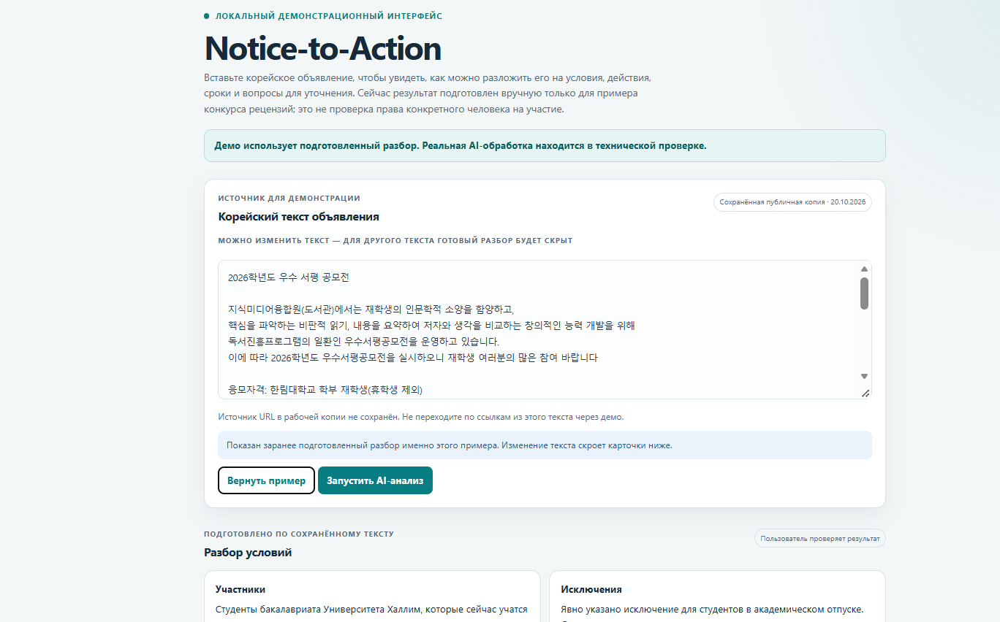
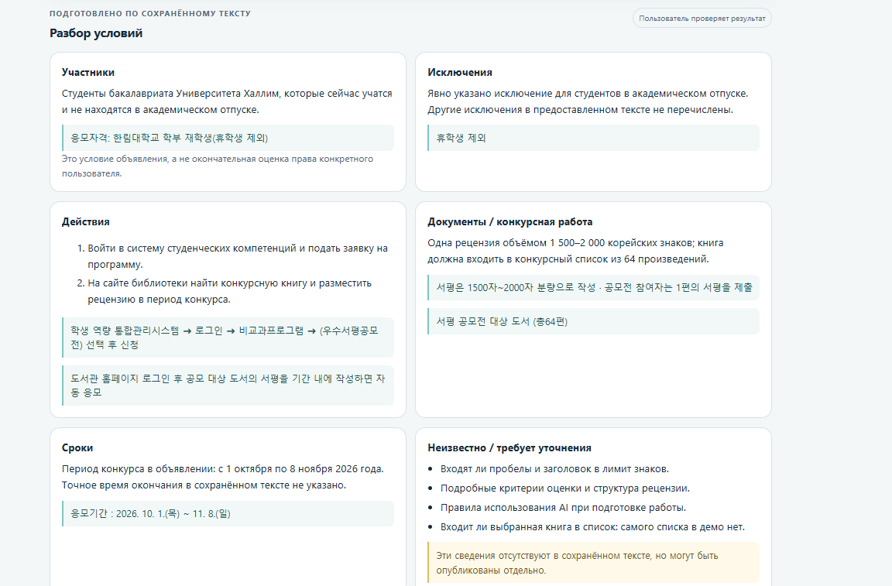
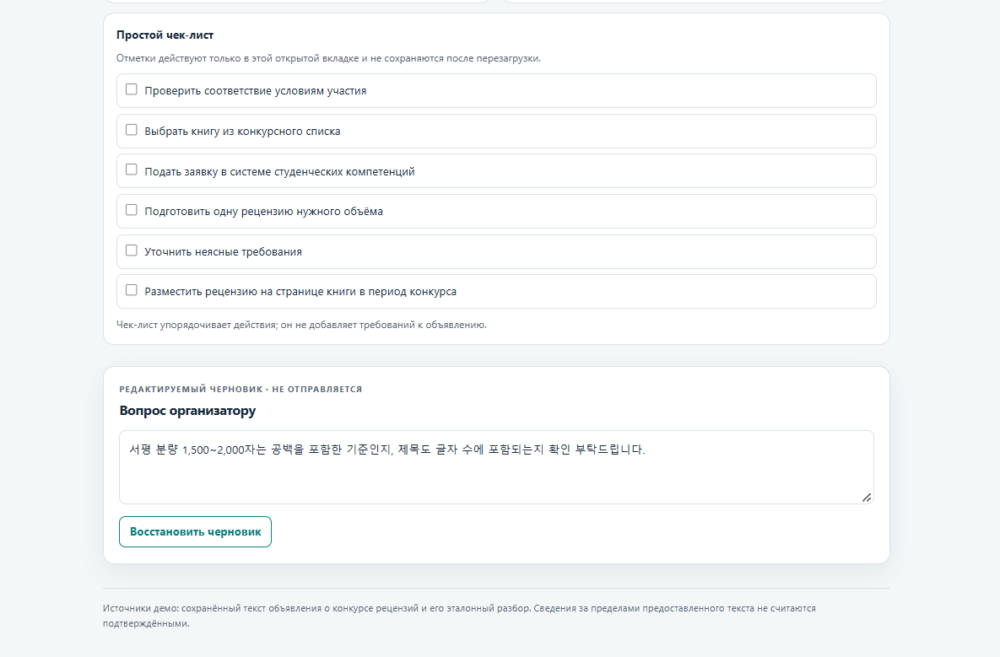

# Notice-to-Action

## Проблема

Корейские объявления о конкурсах и программах могут объединять условия
участия, сроки, требуемые действия и неоднозначные детали. Читателю приходится
разбирать их вручную и отдельно выяснять то, что не указано явно.

## Решение

Notice-to-Action раскладывает объявление на условия, исключения, действия,
документы или конкурсную работу, сроки и вопросы для уточнения.

## Демо

Локальный интерфейс показывает сохранённое публичное объявление о конкурсе
рецензий и подготовленный разбор этого примера. Демо не выполняет AI-анализ
текста и не подставляет подготовленный разбор для другого объявления.

**Демо использует подготовленный разбор. Реальная AI-обработка находится в
технической проверке.**

### Скриншоты демо

Исходное корейское объявление конкурса рецензий.



Подготовленные карточки условий, действий, сроков и вопросов.



Предупреждения об ограничениях и локальном чек-листе демо.



## Ограничения

- Разбор не проверяет право конкретного человека на участие.
- Ссылки в тексте объявления не открываются и не считаются подтверждёнными.
- Наличие цитаты подтверждает только наличие фрагмента в переданном тексте,
  но не правильность его интерпретации.
- Демо и AI-результат не заменяют проверку условий у организатора.

## Установка и запуск

Из корня репозитория выполните в PowerShell:

```powershell
py -3 -m venv .venv
.\.venv\Scripts\python.exe -m pip install -r requirements.txt
powershell -NoProfile -ExecutionPolicy Bypass -File .\start_nta.ps1
```

Для демо ключ не обязателен: если при запросе ключа нажать Enter, сервер
запустится без AI-анализа.

Для AI-анализа создайте `.env` из шаблона, если файл ещё не существует:

```powershell
if (-not (Test-Path .\.env)) { Copy-Item .\.env.example .\.env } else { throw '.env уже существует; команда остановлена, чтобы не перезаписать его.' }
```

Откройте `.env` локально и вставьте свой ключ вместо заглушки. Не отправляйте
ключ в чат. Приложение загружает `.env` из корня репозитория при старте;
переменные окружения, уже заданные в PowerShell, имеют приоритет. Файл `.env`
не публикуется и исключён в `.gitignore`; `.env.example` содержит только
шаблон, а не действительный ключ.

Скрипт запускает сервер только на `127.0.0.1:8000`. Если ключ уже задан в
PowerShell, скрипт не спрашивает его повторно. Если ключа в окружении нет, но
файл `.env` существует, его загрузит приложение. Если нет ни того, ни другого,
скрипт предложит скрытый ввод ключа на текущий запуск. Скрипт не устанавливает
зависимости и не задаёт модель или диагностический вариант. Без явной настройки
`NTA_GEMINI_CONFIG_VARIANT` используется стабильный вариант A; C включается
только при явном выборе переменной.

Остановка сервера: `Ctrl+C`.

## Безопасность

Ключ хранится только в локальном `.env` либо вводится через скрытый запрос
PowerShell и передаётся серверу в переменной окружения процесса. `.env`
исключён из репозитория; ключ не записывается в исходники и не выводится
скриптом. Не публикуйте локальный `.env`.

Файл `.gitignore` исключает локальное виртуальное окружение, кэши,
временные файлы, распространённые форматы ключей и файлы с пометками о личных
данных. `.gitignore` не удаляет ранее добавленные в Git файлы и не может
определить секреты, встроенные в произвольный текст; перед публикацией
проверьте staged-файлы и историю репозитория.

## Локальные проверки

```powershell
.\.venv\Scripts\python.exe -m pytest -q
.\.venv\Scripts\python.exe -m pip check
.\.venv\Scripts\python.exe -m compileall -q app.py provider.py diagnose_gemini_config.py tests
.\.venv\Scripts\python.exe diagnose_gemini_config.py
```

Тесты используют подменённый клиент и не обращаются к Gemini. Диагностический
скрипт выводит только структурные сведения вариантов конфигурации A–D, без
ключа, текста объявления и отправки запроса.
